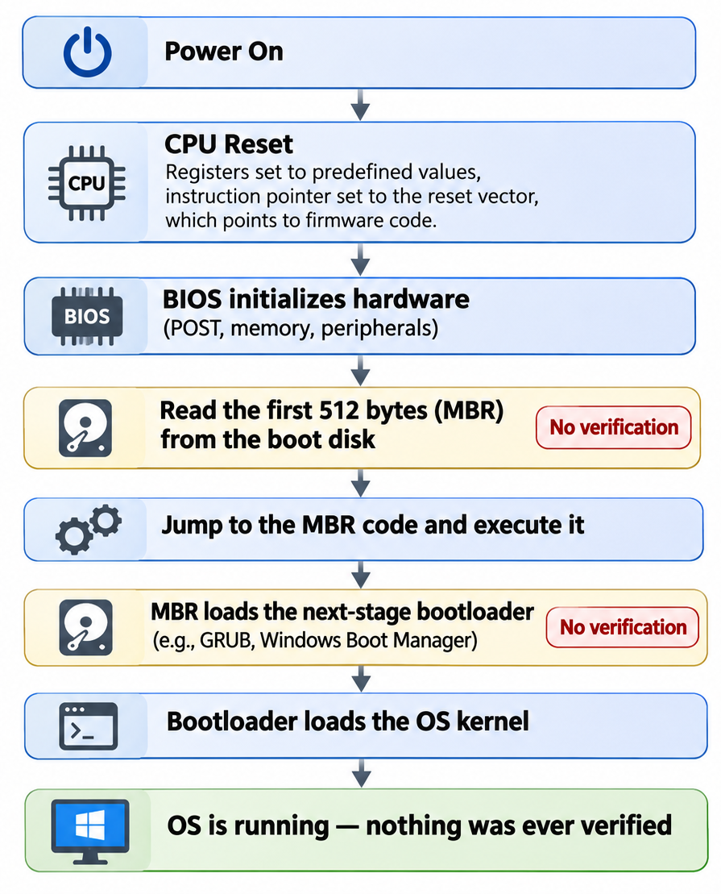
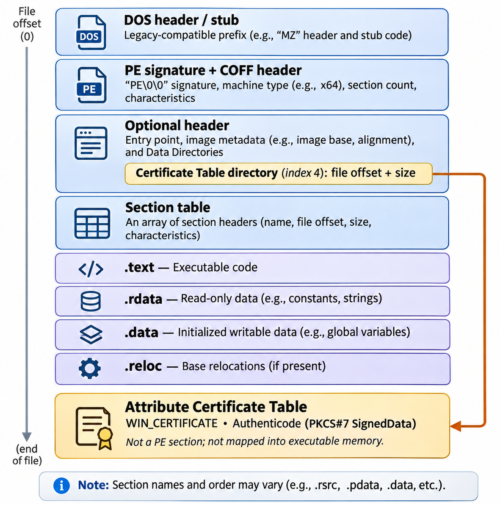
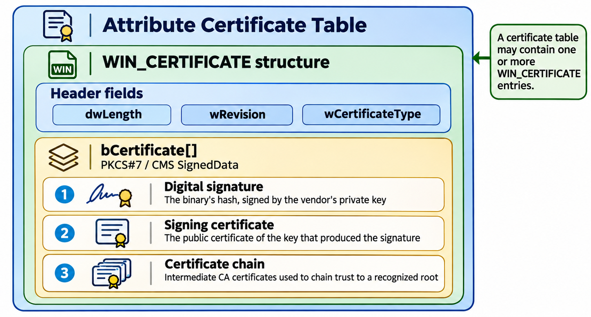
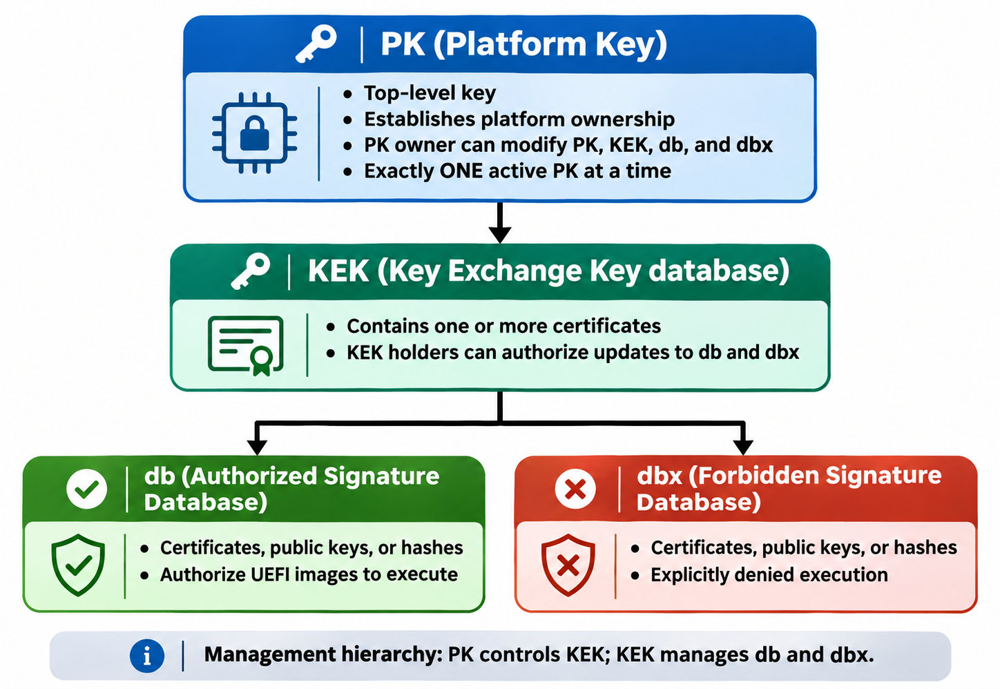
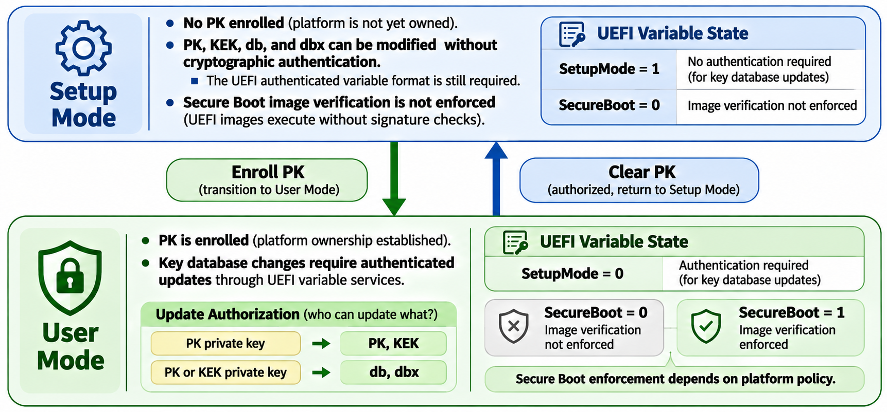
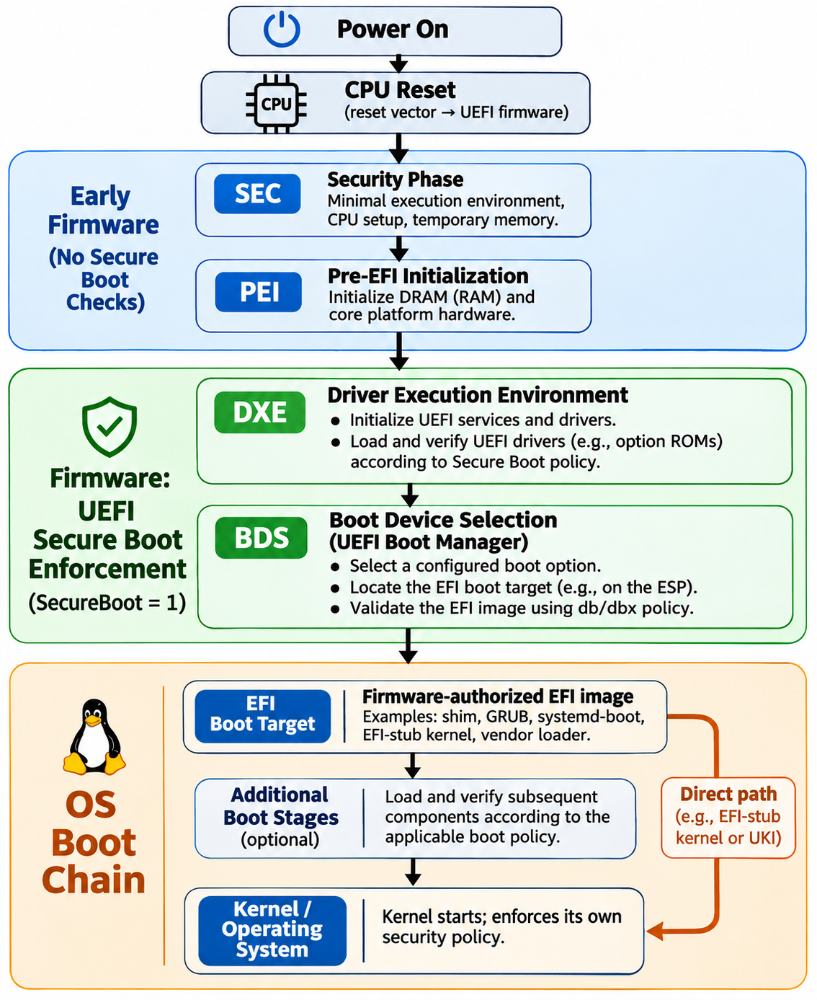
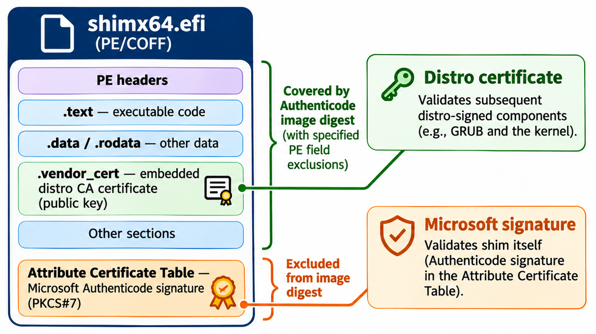
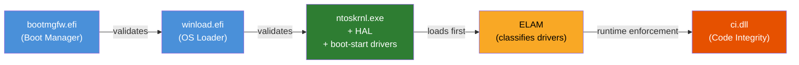
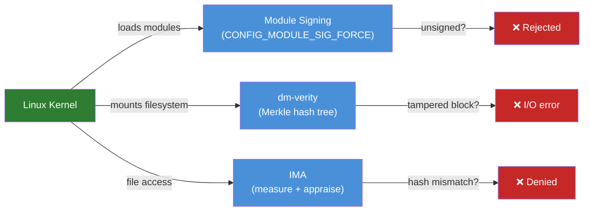

# UEFI Secure Boot

UEFI Secure Boot is a firmware-level security feature defined in the [UEFI specification](https://uefi.org/specs/UEFI/2.11/32_Secure_Boot_and_Driver_Signing.html). It prevents unauthorized code from running during the boot process by verifying digital signatures on every UEFI image before executing it. The keys and certificates used for verification are stored in firmware variables.

> **Related topics not covered here:**
> - [UEFI boot process](https://github.com/ManiAm/os-boot-process/blob/master/docs/02_firmware_bios_and_uefi.md) — firmware phases, ESP, NVRAM
> - [Cryptographic fundamentals](https://github.com/ManiAm/primer-security) — hashing, digital signatures, X.509 certificates, and PKI

## The Problem: No Boot Verification

For decades, firmware had **zero** mechanism to verify the code it was about to execute.

### Legacy BIOS — No Verification at All

Legacy BIOS (the firmware standard used from the early 1980s until UEFI replaced it) had no concept of boot verification. The boot process was:



> **Note:** For full details on each stage see [OS boot process](https://github.com/ManiAm/os-boot-process/blob/master/docs/01_os_boot_process.md).

The BIOS simply read raw bytes from a fixed disk location and jumped to them. If an attacker replaced those bytes with malicious code, the BIOS would execute it without question. There was no standard, no optional feature, no plug-in, and no add-on that provided boot-time signature verification in the BIOS specification.

This made **bootkits** — malware that infects the boot process — straightforward to implement. An attacker who could write to the MBR or boot partition owned the machine from power-on, before any OS security mechanism had a chance to load.

> **Were there any pre-UEFI attempts?** Some hardware vendors implemented proprietary mechanisms (e.g., vendor-specific BIOS password protections or TPM-based measured boot), but these were not standardized boot verification. TPM-based measured boot (available since TPM 1.2, around 2003) **records** what booted — it does not **prevent** unauthorized code from executing. There was no industry-standard verified boot before UEFI Secure Boot.

### UEFI Without Secure Boot — Same Problem

Even early UEFI firmware (before Secure Boot was introduced in UEFI 2.3.1 in 2011) had the same fundamental issue — it loaded and executed EFI binaries from the ESP without any signature verification.

### The Fix

UEFI Secure Boot, introduced in **UEFI specification version 2.3.1 (2011)**, was the first standardized firmware-level mechanism for boot image verification. It requires the firmware to check a cryptographic signature on every UEFI image before executing it. Unsigned or improperly signed code is rejected.


## What Secure Boot Actually Does

Secure Boot applies to **UEFI executable images** — files in the PE/COFF format that UEFI firmware loads and runs. These include:

| UEFI Image Type  | Example |
|------------------|---------|
| OS bootloader    | `grubx64.efi`, `shimx64.efi`, `bootmgfw.efi` |
| UEFI driver      | Network card PXE driver, storage controller driver |
| UEFI application | UEFI Shell, diagnostics tools |
| EFI-stub kernel  | A Linux kernel compiled as an EFI executable |

Before executing any of these, the firmware checks whether the image is **authorized**. If yes, it runs. If no, it is rejected and does not execute.

## How EFI Images Are Signed

Before diving into the trust databases, it helps to understand what a "signed UEFI image" actually looks like — where the signature lives, what gets hashed, and how the firmware verifies it.

### The PE/COFF Format

Every UEFI executable (`.efi` file) uses the **PE/COFF** (Portable Executable / Common Object File Format) binary format — the same format Windows uses for `.exe` and `.dll` files. The diagram below shows the layout of a signed PE/COFF binary:



The key parts for Secure Boot are:

- **DOS header / stub** — A legacy-compatible prefix. Every PE/COFF file begins with the "MZ" magic bytes, inherited from the original DOS executable format.

- **PE signature + COFF header** — Identifies the file as a PE binary (`PE\0\0`), the target machine type (e.g., x64), section count, and characteristics.

- **Optional header** — Contains the entry point, image metadata, and an array of **Data Directories**. Entry at index 4 is the **Certificate Table directory** — it stores the file offset and size of the Attribute Certificate Table at the end of the file (shown by the arrow in the diagram).

- **Section table + sections** — The section table describes each section's name, offset, and size. The sections themselves (`.text`, `.rdata`, `.data`, `.reloc`, etc.) contain the actual code and data. Section names and order vary by binary.

- **Attribute Certificate Table** — This is where the Authenticode signature lives. It is **not** a PE section — it is appended after all sections and is not mapped into executable memory. The firmware locates it using the Certificate Table directory pointer in the Optional Header.

> **Note:** The PE specification calls this the "Attribute Certificate Table." In UEFI and Secure Boot documentation, it is commonly referred to as the "PE Certificate Table." Both names refer to the same structure. This document uses "Attribute Certificate Table" to match the PE specification.

### What Is Inside the Attribute Certificate Table

The Attribute Certificate Table does not contain just a raw signature. It contains one or more `WIN_CERTIFICATE` structures, each holding an **Authenticode signature package** in PKCS#7 / CMS format — a structure that bundles three things together:

> **Note:** Despite the "WIN_" prefix, `WIN_CERTIFICATE` is not Windows-specific. Microsoft originally defined this structure as part of the Authenticode and PE/COFF specifications in the 1990s. When UEFI adopted the PE/COFF format for EFI executables, it inherited `WIN_CERTIFICATE` as the standard signature wrapper. All platforms use it — Linux signing tools (`sbsign`, `pesign`), shim, GRUB, and ARM firmware all read and write `WIN_CERTIFICATE` structures.



As you can see, the signed binary is a **self-contained package** — code, data, signature, and certificates all in one `.efi` file. No separate signature files are needed.

The certificates are included because the verifier needs them to **build the trust chain**. Without them, the verifier would have the signature but no way to determine who signed it or whether that signer is trusted.


### How Signing Works (Build Time)

When a vendor signs an EFI binary, the process is:

```
1. Hash the binary using PE/COFF hashing rules
   (the Attribute Certificate Table area is EXCLUDED from the hash —
    otherwise embedding the signature would change the hash)
         │
         ▼
2. Sign the hash with the vendor's private key
         │
         ▼
3. Package the signature + signing certificate + certificate chain
   into a PKCS#7 structure
         │
         ▼
4. Embed the PKCS#7 package into the Attribute Certificate Table
         │
         ▼
5. Distribute the signed binary
```

### How Verification Works (Boot Time)

When the firmware loads a signed EFI binary, it reverses the process:

```
1. Compute the Authenticode hash of the PE/COFF image
   (same hashing rules as signing — excludes the Attribute Certificate Table)
         │
         ▼
2. Extract the PKCS#7 package from the Attribute Certificate Table
   (this gives the verifier the signature, the signing
    certificate, and the certificate chain)
         │
         ▼
3. Verify the signature (cryptographic check)
   Using the signing certificate's public key, decrypt the
   signature and compare the result against the computed hash.
         │
         ├── Mismatch ──▶ REJECT ❌  (binary was tampered with)
         │
         ▼
4. Check certificate trust
   Is the signing certificate (or any certificate in its chain)
   trusted by the firmware?
         │
         ├── Yes ──▶ EXECUTE ✅
         └── No  ──▶ REJECT ❌
```

The order matters: **signature verification (step 3) happens before the trust check (step 4)**. If the cryptographic signature does not match the hash, the binary has been tampered with and there is no reason to check whether the certificate is trusted. Only after the signature proves the binary is intact does the firmware ask whether the signer is authorized.

> **Note:** Step 4 does not require the signing certificate itself to be directly known to the firmware. Each X.509 certificate carries an **Issuer** field that identifies the certificate authority (CA) that issued it. The firmware walks this chain — signing certificate → intermediate CA → root CA — and considers the binary trusted if **any** certificate in that chain matches a trusted entry. The PKCS#7 package typically includes the intermediate certificates so the firmware can build the full chain.

> **Note:** The firmware can also authorize a binary by its **hash alone**, without examining any signature. The full authorization flow — including hash-based lookups and the role of the trust databases — is explained in the next section.

But how does the firmware decide whether a signing certificate is "trusted," and what does it check the chain against? That is exactly what the next section answers — a pair of databases that the firmware consults at every boot.


## The Trust Databases: db and dbx

The firmware maintains two databases: **db** and **dbx**. Together, they control **what code is allowed to run at boot time**.

### db — The Authorized Signature Database

The **db** (Authorized Signature Database) contains entries that the firmware **trusts**. Each entry can be one of:

| Entry Type | What It Means |
|------------|--------------|
| **Certificate** | Any image signed by this certificate (or a certificate that chains to it) is authorized to execute |
| **Public key** | Any image signed by the corresponding private key is authorized |
| **Hash** | One specific binary, identified by its cryptographic hash, is authorized |

A typical PC ships with several certificates in db. The exact contents depend on the manufacturer. Here are two real-world examples:

**Custom-built desktop (American Megatrends BIOS) — 2 entries:**

| # | db Entry | Type | Purpose |
|---|----------|------|---------|
| 1 | Microsoft Windows Production PCA 2011 | Certificate | Authorizes the Windows bootloader |
| 2 | Microsoft Corporation UEFI CA 2011 | Certificate | Authorizes third-party EFI binaries (including Linux shim) |

**Lenovo ThinkPad (OEM laptop):**

| # | db Entry | Type | Purpose |
|---|----------|------|---------|
| 1 | `14e62a...f436` | SHA-256 hash | Authorizes one specific Lenovo binary |
| 2 | Microsoft Windows Production PCA 2011 | Certificate | Authorizes the Windows bootloader |
| 3 | Microsoft Corporation UEFI CA 2011 | Certificate | Authorizes third-party EFI binaries (including Linux shim) |
| 4 | ThinkPad Product CA 2012 | Certificate | Authorizes Lenovo-specific EFI binaries |
| 5 | Microsoft UEFI CA 2023 | Certificate | Updated Microsoft third-party signing |
| 6 | Microsoft Option ROM UEFI CA 2023 | Certificate | Authorizes option ROMs |

Notice the difference: the OEM laptop has vendor-specific certificates and updated 2023 Microsoft certificates, while the generic desktop has only the two standard Microsoft certificates. Both share the same core Microsoft entries that allow Windows and signed Linux distributions to boot.

### dbx — The Forbidden Signature Database

The **dbx** (Forbidden Signature Database) is the opposite of db. It contains entries that are **explicitly denied**, even if they would otherwise be authorized by db. Each entry can be a certificate, a public key, or a hash — just like db.

dbx is how revocation works. When a bootloader is found to have a security vulnerability, its hash (or its signing certificate) is added to dbx. The firmware will then reject that image, even though it carries a valid signature from a trusted certificate in db. For details on how dbx updates are delivered and the SBAT revocation mechanism, see [Revocation with dbx](#revocation-with-dbx).

**Key rule: dbx is always checked first and takes precedence over db.** If an image matches an entry in both dbx and db, it is rejected.

The number of dbx entries varies significantly across platforms, depending on how many revocation updates the firmware has received:

**Custom-built desktop (American Megatrends BIOS):**

| # | Type | Description |
|---|------|-------------|
| 1–77 | SHA-256 hashes | 77 revoked vulnerable EFI binaries, all from Microsoft |

**Lenovo ThinkPad:**

| # | Type | Description |
|---|------|-------------|
| 1 | SHA-256 hash | Revoked Lenovo-specific binary |
| 2 | SHA-256 hash | Revoked vulnerable EFI binary (Microsoft) |
| 3 | SHA-256 hash | Revoked vulnerable EFI binary (Microsoft) |

The desktop has a much larger dbx because its firmware shipped with (or received) a more comprehensive revocation list. The Lenovo laptop has only 3 entries — likely because it has not received as many dbx updates. Both serve the same purpose: blocking known-vulnerable binaries from executing, even if they carry a valid signature.

### Where Are These Databases Stored?

db and dbx are stored in the firmware's nonvolatile storage — **not on the hard drive**. Wiping the disk, reinstalling the OS, or replacing the hard drive does not change db or dbx. They persist in the firmware until explicitly modified through authorized updates.


## How Authorization Works

When the firmware loads a UEFI image, it checks the image against db and dbx in the following order:

```
Load UEFI image
   │
   ├── 1. Is the image (or its signer) in dbx?
   │        Yes ──▶ REJECT ❌  (dbx always wins)
   │
   ├── 2. Is the image authorized by db?
   │        │
   │        ├── Image has a valid signature, and the signing
   │        │   certificate chains to a certificate in db?
   │        │     Yes ──▶ EXECUTE ✅
   │        │
   │        ├── Image's hash is explicitly listed in db?
   │        │     Yes ──▶ EXECUTE ✅
   │        │
   │        └── Neither?
   │              ──▶ REJECT ❌
   │
   └── Done
```

### Two Authorization Methods

As shown in the flow above, there are two ways for an image to pass the db check:

**1. Trusted signature** (the common method) — The image carries a digital signature. The firmware verifies the signature and checks whether the signing certificate (or a certificate higher in its chain) is listed in db.

A vendor signs all their UEFI images with a code-signing key, and the corresponding certificate is enrolled in db. Any image signed by that key is then authorized. This is how both Windows and Linux boot on most PCs.

**2. Enrolled hash** (for one-off authorizations) — The image's cryptographic hash (computed according to UEFI PE/COFF hashing rules) is explicitly listed in db.

This is used when you need to allow a specific unsigned binary to run — for example, a diagnostics tool. It does not scale well because every individual binary needs its own db entry.


## Who Controls db and dbx: The Key Hierarchy

The previous sections explain **what** db and dbx do. The natural next question is: **who is allowed to add or remove entries in these databases?**

If anyone could modify db, an attacker could simply add their own certificate and boot whatever they want. If anyone could modify dbx, an attacker could remove revocation entries and restore trust in vulnerable binaries. The databases must be protected.

UEFI Secure Boot solves this with a layered key hierarchy. Two additional variables — **PK** and **KEK** — control who can modify db and dbx.

### PK — Platform Key (Who Owns the Platform)

The **PK** (Platform Key) is the top-level key. It establishes who **owns** the platform and has ultimate control over the entire Secure Boot configuration. There is exactly **one** active PK at a time.

The PK owner can:
- Modify **any** Secure Boot variable (PK itself, KEK, db, and dbx)
- Replace the PK to transfer platform ownership

On a typical PC, the PK is set by the OEM (e.g., Lenovo, Dell, HP) during manufacturing.

### KEK — Key Exchange Key (Who Can Update db and dbx)

The **KEK** (Key Exchange Key database) contains one or more certificates. Each KEK holder is authorized to **add or remove entries in db and dbx** — without needing the PK private key.

This is how an OS vendor can push security updates to the trust databases. For example, Microsoft holds a KEK on most PCs, which allows Microsoft to push dbx updates (revoking vulnerable bootloaders) through Windows Update — without needing Lenovo's PK.

### The Complete Hierarchy

The diagram shows the management authority flowing top-down. The **PK** sits at the top — it controls who is in the **KEK** database, and the PK owner can also directly modify db and dbx. The **KEK** sits in the middle — KEK holders can authorize updates to **db** and **dbx** without needing the PK private key. At the bottom, **db** (green, allow) and **dbx** (red, deny) are the databases that the firmware actually consults at boot time. This separation ensures that day-to-day trust management (adding or revoking entries in db/dbx) can be delegated to KEK holders, while ultimate platform control remains with the PK owner.



### Who Holds What

All four variables store **public** keys or certificates in the firmware. The corresponding **private** keys are held by their owners and are never stored in the firmware.

| Variable | Stored in Firmware | Private Key Held By |
|----------|-------------------|-------------------|
| **PK** | One public certificate | Platform owner (OEM, enterprise, or device owner) |
| **KEK** | One or more public certificates | KEK owners (e.g., OEM, OS vendor) |
| **db** | Certificates, keys, or hashes | Signing key owners (e.g., OS vendor, driver vendor) |
| **dbx** | Certificates, keys, or hashes | Updated by KEK or PK owner |

Here is what the key hierarchy looks like on a typical Lenovo ThinkPad:

| Variable | Contents |
|----------|----------|
| **PK** | Lenovo Ltd. PK CA 2012 (Lenovo owns the platform) |
| **KEK** | Lenovo Ltd. KEK CA 2012, Microsoft Corporation KEK CA 2011, Microsoft Corporation KEK 2K CA 2023 |
| **db** | Microsoft Windows Production PCA 2011, Microsoft Corporation UEFI CA 2011, ThinkPad Product CA 2012, and others |
| **dbx** | Hashes of known-vulnerable binaries |

Both Lenovo and Microsoft hold KEK entries, so both can push db/dbx updates. Only Lenovo holds the PK, so only Lenovo has ultimate control over the platform.


## Authenticated Variables

The key hierarchy defines **who** is authorized to modify the databases. But how does the firmware actually **enforce** this? The answer is **authenticated variables**.

The PK, KEK, db, and dbx are stored as **UEFI authenticated variables** — a special type of UEFI variable that cannot be modified without cryptographic proof of authorization.

An authenticated variable can only be updated by providing:

1. The new value.
2. A digital signature over the new value, made with the appropriate private key.
3. A monotonic timestamp or counter to prevent replay of old updates.

The firmware verifies the signature before accepting the update. This means that even if an attacker has full OS-level access and can call UEFI runtime services, they still cannot modify db or dbx without the KEK or PK private key.

```
Attacker with root access tries to add their certificate to db:

   SetVariable("db", new_data, no_valid_signature)
       │
       ▼
   UEFI firmware checks signature ──▶ Invalid ──▶ Update REJECTED ❌
```

| Update Target | Requires Signature From |
|---------------|------------------------|
| **db** or **dbx** | KEK private key or PK private key |
| **KEK** | PK private key |
| **PK** | Current PK private key (to replace it) |

This is what makes Secure Boot resilient to software-only attacks. The private keys that control the databases are never stored on the device.


## Setup Mode and User Mode

Secure Boot has two modes that answer a simple question: **is the platform open for key enrollment, or is it locked down?**

- **Setup Mode** — The platform is "open." No PK is enrolled, so the key databases can be freely configured. This is intended for initial setup.
- **User Mode** — The platform is "locked." A PK is enrolled, so the key databases are protected by authenticated updates.

The trigger that switches between them is the **PK**:

- **Enroll a PK** → platform moves from Setup Mode to User Mode.
- **Clear the PK** → platform returns to Setup Mode.



### Setup Mode

When no PK is enrolled, the platform is in **Setup Mode**. In this mode:

- The key databases (PK, KEK, db, dbx) can be modified **without cryptographic authentication** — no existing key is needed to sign the update. (The updates must still use the UEFI authenticated variable format, but the firmware does not verify the signature.)

- Secure Boot image verification is **not enforced** — the firmware does not check signatures on UEFI images before executing them.

Setup Mode exists so that the platform owner can perform the initial key enrollment. Without it, there would be a chicken-and-egg problem: you need a key to authorize changes, but there is no key yet.

### User Mode

Once a PK is enrolled, the platform transitions to **User Mode**. In this mode:

- Changes to PK, KEK, db, and dbx require **authenticated updates** — the update must be signed by the appropriate private key (PK for PK/KEK changes; KEK or PK for db/dbx changes).

- Unauthorized modification of the databases is blocked.

### An Important Distinction: User Mode ≠ Secure Boot On

A common misconception is that entering User Mode automatically turns on Secure Boot image verification. It does not. The firmware tracks these as **two separate things** using two independent variables:

| Variable     | What It Controls |
|--------------|-----------------|
| `SetupMode`  | Whether the key databases require authenticated updates (`1` = no authentication, `0` = authentication required) |
| `SecureBoot` | Whether the firmware verifies image signatures at boot (`1` = verification on, `0` = verification off) |

Enrolling a PK sets `SetupMode` to `0` (User Mode). But the `SecureBoot` variable is controlled separately by **platform policy** — a platform-specific configuration set by the firmware vendor or OEM.

This means three distinct states are possible:

| State                                | SetupMode | UserMode | SecureBoot | Key Database Protection    | Image Verification |
|--------------------------------------|-----------|----------|------------|----------------------------|--------------------|
| **Setup Mode**                       | 1         | 0        | 0          | No authentication required | Not enforced |
| **User Mode — enforcement disabled** | 0         | 1        | 0          | Authentication required    | Not enforced |
| **User Mode — enforcement enabled**  | 0         | 1        | 1          | Authentication required    | Enforced |

Which state a platform ships in depends on the product category:

- **OEM pre-built systems** (Dell, Lenovo, HP laptops and desktops) — These are "Certified for Windows" devices. Microsoft's [Windows Hardware Compatibility Program](https://learn.microsoft.com/en-us/windows-hardware/design/device-experiences/oem-secure-boot) requires them to ship in User Mode with enforcement enabled (`SetupMode = 0`, `SecureBoot = 1`) and keys pre-enrolled.

- **Retail motherboards** (ASUS, Gigabyte, MSI, ASRock) — These are sold as standalone components, not as certified systems. They typically ship in Setup Mode with Secure Boot disabled and no keys enrolled. To enable Secure Boot, the user must enter the firmware setup utility, install the factory default keys (often labeled "Restore Factory Keys" or "Install Default Secure Boot Keys"), and then enable Secure Boot.

> **Note:** The UEFI specification also defines **Audit Mode** and **Deployed Mode** for advanced lifecycle management. They are omitted here for simplicity.

> **Note:** Some firmware implementations also allow database modifications through a physically accessible firmware setup menu, providing an out-of-band path that does not require signed variable payloads.


## Boot Flow with Secure Boot

Here is the complete boot flow on a typical Linux system with Secure Boot enabled. This brings together concepts from the previous sections — the trust databases (db/dbx), the authorization checks, and User Mode enforcement.

When you press the power button, the firmware does not immediately start checking signatures. It goes through several initialization phases first. Secure Boot only kicks in once the firmware is ready to load external code (drivers, bootloaders).



The diagram shows three distinct zones:

- **Early Firmware** — SEC and PEI phases. The firmware is initializing basic hardware. Secure Boot is not involved yet.

- **Firmware: UEFI Secure Boot Enforcement** — DXE and BDS phases. Secure Boot is active and verifying external code — UEFI drivers, option ROMs, and the EFI boot target — against db/dbx.

- **OS Boot Chain** — After the firmware verifies and launches the EFI boot target, UEFI Secure Boot's job is done. The rest of the chain continues outside the firmware, as described in [After BDS: The Bootloader Handoff](#after-bds-the-bootloader-handoff) below.

### UEFI Firmware Phases

Here is when each phase happens and where Secure Boot fits in:

| Phase | What Happens | Secure Boot Role |
|-------|-------------|-----------------|
| **SEC** (Security) | The very first instructions run from the SPI flash chip. Sets up minimal CPU state and temporary memory. | ❌ Not involved — Secure Boot does not exist yet |
| **PEI** (Pre-EFI Init) | Initializes the main system memory (RAM) and core platform hardware. | ❌ Not involved — still too early |
| **DXE** (Driver Execution) | The main firmware phase. Loads drivers for storage, network, graphics, and other hardware. Also reads the Secure Boot configuration (db, dbx, PK, KEK) from firmware variables. | ✅ Secure Boot **starts here** — once initialized, it verifies DXE drivers and option ROMs before they execute |
| **BDS** (Boot Device Selection) | The firmware's boot manager. Looks at the boot order, finds the bootloader on the ESP, and prepares to launch it. | ✅ Secure Boot **verifies the bootloader** before handing off control |

> **Note:** Because SEC and PEI run before Secure Boot, they are implicitly trusted. If an attacker tampers with these early phases, Secure Boot cannot help. Protecting them requires hardware-rooted mechanisms (see [Hardware Root of Trust](#hardware-root-of-trust)).

### After BDS: The Bootloader Handoff

Once BDS verifies and launches the EFI boot target, UEFI Secure Boot's job is done. This is the yellow "OS Boot Chain" zone in the diagram. From here, the boot target and kernel are responsible for continuing the verification chain on their own.

The diagram shows three boxes in this zone, matching the three steps of the handoff:

| Step | Diagram Box | What Happens |
|------|------------|-------------|
| 1 | **EFI Boot Target** | The firmware-authorized EFI image starts running. This could be shim, GRUB, systemd-boot, an EFI-stub kernel, a vendor loader, or a Unified Kernel Image (UKI). |
| 2 | **Additional Boot Stages** (optional) | If the boot target is not the kernel itself, it loads and verifies the next component according to its own policy. For example, shim verifies GRUB, then GRUB verifies the kernel. |
| 3 | **Kernel / Operating System** | The kernel starts and enforces its own security (module signatures, lockdown mode, etc.). |

Notice the direct path arrow on the right side of the diagram: if the EFI boot target is already the kernel (EFI-stub or UKI), step 2 is skipped entirely — the firmware verifies the kernel directly, and no intermediate bootloader is needed.

Here are some common examples of what the EFI boot target can be:

| Platform | EFI Boot Target | What happens next |
|----------|----------------|------------------|
| **Linux with shim** (most PCs) | `shimx64.efi` — signed by Microsoft | shim → GRUB → kernel (details in [The shim Bootloader](#the-shim-bootloader)) |
| **Linux without shim** (custom keys) | `grubx64.efi` or another bootloader — signed by the owner's key in db | Bootloader verifies the kernel directly |
| **Linux EFI-stub / UKI** | The kernel itself — compiled as an EFI executable and signed | Firmware verifies the kernel directly; no bootloader needed |
| **Windows** | `bootmgfw.efi` — signed by Microsoft | Windows Boot Manager continues its own verified chain |
| **Embedded device** | Vendor's bootloader or kernel — signed by the vendor's key in db | Vendor controls the entire chain |


## The shim Bootloader

On most Linux distributions, the first UEFI executable is not GRUB directly — it is **shim**. Understanding why requires knowing how the PC ecosystem's Secure Boot trust model works.

### The Problem shim Solves

Most PCs ship with **Microsoft's certificates** in db, because Microsoft is the dominant OS vendor. Linux distributions cannot get every PC vendor to add their certificates to db at the factory. And users should not have to disable Secure Boot just to run Linux.

The solution: Microsoft signs a small first-stage bootloader called **shim** with their UEFI third-party signing key (which is in db on most PCs). shim then contains or manages its own set of trusted keys to verify the actual GRUB bootloader and kernel.

```
BDS (UEFI Boot Manager) — db contains Microsoft's certificate
   │
   ├── Loads shimx64.efi from ESP
   │     Verifies against db/dbx ──▶ ✅                    ← UEFI Secure Boot
   │
   ▼
shim (contains the distro's signing certificate)
   │
   ├── Loads grubx64.efi
   │     Signature check: signed by the distro ──▶ ✅      ← shim's own verification
   │
   ▼
GRUB
   │
   ├── Loads the kernel
   │     Signature check: signed by the distro ──▶ ✅      ← shim's verification (via API)
   │
   ▼
Linux Kernel
```

Only the first step — firmware loading `shimx64.efi` — is UEFI Secure Boot. The firmware checks shim's signature against db/dbx, and once shim passes, the firmware's job is done. Everything after that is **shim's own verification chain** — a separate trust system that shim manages independently of the firmware, using the distro's own keys.

The firmware only needs to trust **one binary** — shim, signed by Microsoft. From there, shim handles everything else using the distro's own keys. Without this design, Microsoft would need to sign every new GRUB version and every new kernel release for every Linux distribution — which would be impractical.

### What Is Inside shim

shim contains two important things — and they serve different purposes:

1. **Microsoft's signature** (on the outside) — This is the Authenticode signature in shim's Attribute Certificate Table, applied by Microsoft after the distro submits the binary for signing. The firmware checks this signature against db during BDS. It is the reason the firmware trusts shim.

2. **The distro's certificate** (embedded inside) — This is a certificate that the distro baked into shim's code at build time, before sending it to Microsoft. Shim uses this certificate to verify GRUB and the kernel. The firmware never sees or uses this certificate — it is entirely shim's business.

Each distro builds its own version of shim with its own certificate embedded inside. For example, Ubuntu's shim contains Canonical's certificate, Fedora's shim contains Red Hat's certificate, and so on. This means every distro's shim is a **unique binary** with a different hash — but all of them carry Microsoft's signature on the outside, so all of them pass the firmware's db check.



### MOK — Machine Owner Key

The embedded distro certificate covers everything the distro itself signs and ships — GRUB, the kernel, and distro-provided modules. But what about software the distro did **not** sign? For example, NVIDIA's proprietary GPU driver or VirtualBox kernel modules are third-party software — they are not signed by the distro.

For this, shim supports a **Machine Owner Key (MOK)** database — a secondary trust store that the user controls. MOK is stored in UEFI variables and managed through `mokutil` (a command-line tool) and **MokManager** (a small UEFI application that shim launches when MOK changes are pending). MOK allows users to:

- Enroll their own signing keys
- Trust self-signed or third-party kernel modules (e.g., NVIDIA drivers, VirtualBox)
- Add certificates without modifying the firmware's db

MOK enrollment requires **physical presence** — the user must confirm the enrollment at the console during boot, preventing remote attackers from silently adding trust.

> **Note:** shim and MOK are not part of the UEFI specification itself. They are a Linux ecosystem solution built on top of UEFI Secure Boot's extension points.

### How shim's Verification Chain Works

Now that we know what keys shim uses — the embedded distro certificate and the MOK database — here is exactly who verifies what:

| Step          | Who loads it  | Who verifies it | Keys used |
|---------------|---------------|-----------------|-----------|
| `shimx64.efi` | UEFI firmware | UEFI firmware (Secure Boot) | Firmware's db — Microsoft's certificate |
| `grubx64.efi` | shim          | shim                        | Distro's certificate embedded in shim (e.g., Canonical's key for Ubuntu) |
| Linux kernel  | GRUB          | shim (GRUB calls back into shim's verification API) | Distro's certificate + MOK database |

Notice that GRUB does not verify the kernel on its own. When GRUB needs to check a signature, it calls an API that shim registered when it first started. Shim then performs the actual verification using the distro's key and the MOK database.

### Real-World Example: Examining shimx64.efi

We can see **Microsoft's signature** (item 1 — the "outside" signature) on a real shim binary using `sbverify --list`, a Linux tool for inspecting Authenticode signatures on PE binaries:

```
$ sbverify --list /boot/efi/EFI/ubuntu/shimx64.efi

signature 1
image signature issuers:
 - Microsoft Corporation UEFI CA 2011
image signature certificates:
 - subject: Microsoft Windows UEFI Driver Publisher
   issuer:  Microsoft Corporation UEFI CA 2011
 - subject: Microsoft Corporation UEFI CA 2011
   issuer:  Microsoft Corporation Third Party Marketplace Root
```

This is from a Lenovo ThinkPad running Ubuntu. The PKCS#7 package contains **one signature** with a **two-certificate chain**:

| Certificate | Role |
|-------------|------|
| Microsoft Windows UEFI Driver Publisher | The end-entity certificate whose private key signed the binary |
| Microsoft Corporation UEFI CA 2011 | The issuing CA — this is the certificate the firmware looks up in db |

This is what the firmware checks during BDS:

1. Hashes `shimx64.efi` using PE/COFF hashing rules
2. Extracts the PKCS#7 package from the Attribute Certificate Table
3. Verifies the signature against the hash using the certificates above
4. Checks: does `Microsoft Corporation UEFI CA 2011` appear in db? On this ThinkPad, it does ✅
5. Executes `shimx64.efi`

> **Note:** `sbverify --list` only shows Microsoft's Authenticode signature in the Attribute Certificate Table — the "outside" layer. It does not show the **distro's certificate** (item 2) that is compiled into shim's binary data. That certificate is not part of the PE signature structure — it lives inside shim's code and is only used by shim itself after it starts running.


## Revocation with dbx

As described earlier, dbx blocks code that would otherwise be authorized by db. This section covers how revocation entries work in practice, how updates are delivered, and the SBAT mechanism that addresses scaling.

The specific dbx entry types enable different revocation strategies:

| dbx Entry Type | What It Blocks |
|----------------|---------------|
| **Certificate hash** | Any image signed by that specific certificate |
| **Image hash** | One specific binary (identified by its PE/COFF hash) |
| **Certificate** | Any image chaining to that certificate |

### How dbx Updates Are Delivered

dbx updates are delivered as signed variable payloads, typically through OS updates:

1. The OS vendor or a coordination body (like the UEFI Forum or Microsoft) prepares a new dbx list.
2. The update is signed with a KEK private key.
3. The signed update is distributed via OS update mechanisms.
4. The OS applies the update by calling `SetVariable()` with the signed payload.
5. Firmware verifies the KEK signature and applies the update.

```
dbx update flow:

   KEK holder signs new dbx entries
      │
      ▼
   OS distributes signed update
      │
      ▼
   OS calls SetVariable("dbx", signed_payload)
      │
      ▼
   Firmware verifies KEK signature ──▶ Valid ──▶ dbx updated ✅
                                       Invalid ──▶ Rejected ❌
```

> **Important:** UEFI firmware does not perform online revocation checks (no OCSP, no CRL fetching). It only knows what is in its local dbx. If a device never receives a dbx update, it will continue to trust revoked binaries.

### SBAT — Secure Boot Advanced Targeting

Traditional dbx revocation has a scaling problem: every individual vulnerable binary needs its own hash entry in dbx. With many Linux distributions shipping many GRUB and shim versions, dbx can grow large.

**SBAT** (Secure Boot Advanced Targeting) is a metadata-based revocation mechanism used by shim and GRUB. Instead of listing individual binary hashes, SBAT uses a generation number embedded in each binary:

```
Example SBAT metadata in a GRUB binary:

   sbat,1,SBAT Version,sbat,1,https://github.com/rhboot/shim/blob/main/SBAT.md
   grub,4,Free Software Foundation,grub,2.12,https://www.gnu.org/software/grub/
```

The shim bootloader maintains a minimum acceptable SBAT generation. Any binary with a generation number below the minimum is rejected — blocking entire classes of vulnerable binaries with a single policy update, instead of needing a separate dbx hash for each one.

> **Note:** SBAT is a shim/GRUB ecosystem mechanism, not part of the UEFI specification itself.


## Limitations of Secure Boot

### Software Root of Trust

Secure Boot's root of trust is the [PK](#pk--platform-key-who-owns-the-platform). Every trust decision traces back to it: PK controls KEK, KEK controls db/dbx, and db/dbx control what code the firmware allows to run. If you trust the PK, you trust the entire chain below it.

But the PK is a **software root of trust**. It is stored as an authenticated variable in the firmware's nonvolatile (NV) memory — typically a small flash chip on the motherboard. The same is true for KEK, db, and dbx. The UEFI firmware is responsible for protecting these variables and enforcing the rules around them.

This creates a fundamental problem: **who verifies the firmware itself?**

Secure Boot cannot — it **is** the firmware. The firmware is the one reading the PK, checking signatures, and enforcing the rules. If an attacker modifies the firmware image stored in the SPI flash chip (for example, by reflashing the chip physically or exploiting a firmware update vulnerability), they can:

- Tamper with the PK, KEK, db, or dbx values stored in NV memory
- Modify the Secure Boot enforcement logic itself
- Make the firmware report that Secure Boot is enabled when it is actually doing nothing

In other words, if the firmware is compromised, the entire software root of trust collapses — the PK and all the databases it protects become meaningless. Addressing this requires a [hardware root of trust](#hardware-root-of-trust) that verifies the firmware before it runs.

### No Rollback Prevention

Secure Boot will happily boot an **older, vulnerable** but validly signed image. For example, if version 1.0 of a bootloader has a critical vulnerability and version 2.0 fixes it, Secure Boot treats both as valid — both carry a legitimate signature. An attacker could replace version 2.0 with version 1.0 on the ESP and exploit the known vulnerability.

This is partially addressed within the Secure Boot ecosystem:

- **dbx revocation** — Explicitly adding the hash or signing certificate of the vulnerable binary to the Forbidden Signature Database. However, this is a manual process (the entry must be published and deployed) and dbx has limited storage (~32 KB on typical PCs).

- **SBAT (Secure Boot Advanced Targeting)** — Blocks entire classes of vulnerable binaries using a generation number instead of individual hashes, without consuming dbx space (see [SBAT — Secure Boot Advanced Targeting](#sbat--secure-boot-advanced-targeting) above for details).


## Beyond Secure Boot

### Hardware Root of Trust

Secure Boot's [software root of trust](#software-root-of-trust) can be undermined if the firmware itself is compromised. A **hardware root of trust** solves this by moving the starting point of the trust chain into the CPU silicon — something an attacker cannot modify:

- **Intel Boot Guard** — A hash of the firmware signing key is burned into one-time-programmable (OTP) fuses on the CPU during manufacturing. These fuses are permanent and cannot be changed. When the machine powers on, the CPU's Authenticated Code Module (ACM) verifies the first firmware code (the Initial Boot Block) against this fused key hash — before any UEFI code runs. If the firmware has been tampered with, the CPU refuses to execute it. Once the verified firmware starts, it initializes UEFI Secure Boot, which continues the chain from the DXE phase onward.

- **AMD Platform Secure Boot (PSB)** — AMD's equivalent. The AMD Security Processor (a dedicated ARM core on the CPU die) verifies the first firmware stage against keys fused into the chip.

With a hardware root of trust, the full chain becomes:

```
Power On
   │
   ▼
CPU Reset
   │
   ▼
CPU fuses (hardware, immutable)
   │
   ▼
Firmware verification (Boot Guard / PSB)
   │
   ▼
UEFI Secure Boot (PK → KEK → db/dbx)
```

Each layer verifies the next, and the chain starts from something an attacker cannot modify — the CPU silicon itself.

### Runtime Protection

As described in [After BDS: The Bootloader Handoff](#after-bds-the-bootloader-handoff), Secure Boot's job ends once the firmware launches the EFI boot target. It does not verify OS binaries, kernel modules, or anything that runs afterward. Both Windows and Linux extend the trust chain into runtime:

**On Windows:**



- **bootmgfw.efi** (verified by firmware via Secure Boot) validates **winload.efi**
- **winload.efi** validates **ntoskrnl.exe** (the kernel), the Hardware Abstraction Layer, and all boot-start drivers using its own built-in code-integrity verifier (`bootlib`)
- **Early Launch Anti-Malware (ELAM)** loads before any third-party boot driver and classifies each one as known-good, known-bad, or unknown — blocking known-bad drivers
- Once the kernel is running, **Code Integrity (`ci.dll`)** enforces signature requirements on every kernel-mode driver loaded at runtime

**On Linux:**



- **Kernel module signing** — The kernel can require that all loadable modules carry a valid signature. With `CONFIG_MODULE_SIG_FORCE` enabled, unsigned or improperly signed modules are rejected at load time.
- **dm-verity** — Protects read-only filesystems (such as the root partition) by verifying every disk block against a Merkle hash tree. If a single byte on the filesystem has been modified, the read fails. Used extensively on Android, Chrome OS, and container/IoT deployments.
- **IMA (Integrity Measurement Architecture)** — A kernel subsystem that can measure files at runtime (recording hashes into TPM PCR 10 for attestation) and optionally **appraise** them (rejecting execution of files that do not match a known-good hash or signature).

### Measured Boot and Attestation

Secure Boot makes a binary decision at boot time: allow or reject. But it keeps no record. After the OS is running, there is no way to prove what booted or whether Secure Boot was even enabled. Secure Boot is a **gatekeeper**, but it is not a **witness**.

Measured Boot with a TPM (Trusted Platform Module) fills this role. As each boot component loads, the firmware computes a hash of that component and **extends** it into one of the TPM's Platform Configuration Registers (PCRs). "Extending" means the new hash is combined with the existing PCR value and re-hashed — this is a one-way operation, so PCR values cannot be forged or rolled back.

The result is a tamper-evident record of everything that executed during boot:

| PCR   | What It Records |
|-------|----------------|
| PCR 0 | Core firmware (SRTM, BIOS) |
| PCR 1 | Firmware configuration |
| PCR 2 | Option ROM code |
| PCR 4 | Boot loader (e.g., `bootmgfw.efi`, `shimx64.efi`) |
| PCR 7 | Secure Boot state (whether it was on, the contents of db/dbx/KEK/PK) |

This tamper-evident record can then be used for **sealing** (releasing secrets only if the boot chain matches expected values) and **remote attestation** (proving to a remote server what code actually booted).

It is important to note that Secure Boot and Measured Boot are **independent** — neither requires the other:

| | Secure Boot | Measured Boot |
|---|---|---|
| **Defined by** | UEFI Specification | TCG (Trusted Computing Group) Specifications |
| **Requires** | UEFI firmware with Secure Boot support | TPM (hardware chip) |
| **What it does** | Verifies signatures and blocks unauthorized code | Records hashes of what code executed |
| **Enforcement** | Yes — reject or allow | No — observe and record only |
| **Alone** | Prevents unauthorized code but leaves no proof | Records everything but blocks nothing |

The strongest posture uses both: Secure Boot **prevents**, Measured Boot **proves**.

> For details on PCR usage, sealing, and attestation, see the [TPM reference](https://github.com/ManiAm/TPM/blob/master/docs/02-TPM-internals.md#platform-configuration-registers-pcrs).


## References

| Reference | What It Covers |
|-----------|---------------|
| [UEFI Specification 2.11 — Secure Boot and Driver Signing](https://uefi.org/specs/UEFI/2.11/32_Secure_Boot_and_Driver_Signing.html) | The authoritative specification: PK, KEK, db, dbx, image verification, authenticated variables |
| [UEFI Specification 2.11 — Variables and Variable Services](https://uefi.org/specs/UEFI/2.11/08_Services_Runtime_Services.html#variable-services) | Authenticated variable update mechanism |
| [NIST SP 800-147: BIOS Protection Guidelines](https://csrc.nist.gov/pubs/sp/800/147/final) | Platform firmware protection recommendations |
| [NIST SP 800-147B: Server BIOS Protection](https://csrc.nist.gov/pubs/sp/800/147/b/final) | Server platform firmware protection |
| [shim — Linux Foundation](https://github.com/rhboot/shim) | shim bootloader source and documentation |
| [SBAT specification](https://github.com/rhboot/shim/blob/main/SBAT.md) | Secure Boot Advanced Targeting revocation mechanism |
| [sbctl — Secure Boot key manager](https://github.com/Foxboron/sbctl) | Tool for managing custom Secure Boot keys on Linux |
| [Trusted Platform Module (TPM)](https://github.com/ManiAm/TPM) | TPM 2.0 architecture, measured boot, PCRs, sealing, attestation |
| [NSA — Boot Security Modes and Recommendations](https://www.nsa.gov/portals/75/documents/what-we-do/cybersecurity/professional-resources/csi-boot-security-modes-and-recommendations.pdf) | How Secure Boot, TPM, and measured boot complement each other |
| [Intel Boot Guard — Secure Boot Methodologies](https://builders.intel.com/docs/networkbuilders/secure-the-network-infrastructure-secure-boot-methodologies.pdf) | Hardware-rooted firmware verification, Intel Boot Guard architecture |
| [Linux Kernel Module Signing](https://docs.kernel.org/admin-guide/module-signing.html) | Kernel module signature verification facility |
| [IMA and EVM Concepts](https://ima-doc.readthedocs.io/en/latest/ima-concepts.html) | Linux Integrity Measurement Architecture — measurement, appraisal, and audit |
| [Secure the Windows Boot Process](https://learn.microsoft.com/en-us/windows/security/operating-system-security/system-security/secure-the-windows-10-boot-process) | Windows Trusted Boot, ELAM, and code integrity |

---

[Next: Secure Boot in Practice →](02_secure_boot_in_practice.md)
