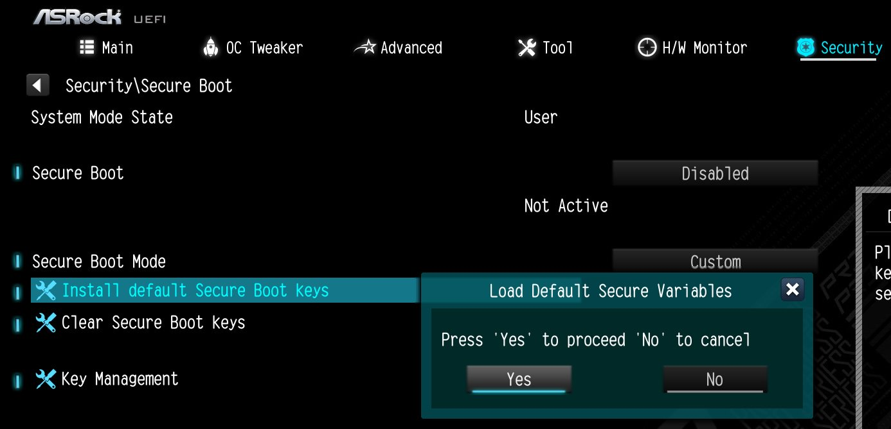

# Secure Boot in Practice

> **Prerequisite:** This document assumes familiarity with the Secure Boot key hierarchy (PK, KEK, db, dbx), Setup Mode, and User Mode. See [UEFI Secure Boot](01_secure_boot.md) for the full explanation.

This document covers two paths for enabling Secure Boot on a real machine:

1. **Factory keys** — Install the vendor-provided default keys and use the standard Microsoft trust model. This is what most PC users do.

2. **Custom keys** — Replace the vendor keys with your own and control exactly what can boot. This is used by embedded devices, enterprise fleets, and security-conscious users.

Both paths are demonstrated on an **ASRock X299 Taichi CLX** motherboard with AMI UEFI firmware.


## Enabling Secure Boot with Factory Keys

This section walks through enabling Secure Boot using the factory default keys. This is the standard path for most users who want Secure Boot on a DIY-built PC. The screenshots below are from the board's AMI UEFI firmware (branded "Taichi UEFI").

### Step 1: Starting Point — Setup Mode

The board ships with no Secure Boot keys enrolled. In the UEFI setup utility under **Security → Secure Boot**, the firmware shows:

- **System Mode State: Setup** — No PK is enrolled, so the platform is in [Setup Mode](01_secure_boot.md#setup-mode).
- **Secure Boot: Disabled / Not Active** — Enforcement is off. The firmware will not verify signatures on UEFI images.

When we try to enable Secure Boot in this state, the firmware refuses with a clear message:

> *"System in Setup Mode! Secure Boot can be enabled when System in User Mode. Repeat operation after enrolling Platform Key (PK)"*

This is the chicken-and-egg situation described in the [Setup Mode and User Mode](01_secure_boot.md#setup-mode-and-user-mode) section: Secure Boot requires a PK to establish the trust root, but no PK exists yet. The firmware will not enforce signatures when it has no keys to check against.

### Step 2: Installing the Factory Default Keys

The firmware provides a one-click option: **"Install default Secure Boot keys"**. Selecting it populates all four Secure Boot databases in a single operation:



After clicking "Install default Secure Boot keys" and confirming, the firmware writes a complete set of pre-built certificates and hashes into the Secure Boot variables. These are not generated on the fly — they are **embedded in the firmware image** that ASRock ships with the board (or provides via BIOS updates). The firmware stores them internally and copies them into the UEFI authenticated variables when you select the install option.

Here is what gets installed:

| Variable | What Is Installed | Source |
|----------|------------------|--------|
| **PK** (Platform Key) | One certificate identifying the platform owner | The board vendor (ASRock) or its firmware supplier (AMI). This is the root of the Secure Boot hierarchy on this machine. |
| **KEK** (Key Exchange Key) | One Microsoft certificate — `Microsoft Corporation KEK CA 2011` (or `KEK 2K CA 2023` on updated firmware) | Microsoft provides this to motherboard vendors. It allows Microsoft to push db/dbx updates through Windows Update without needing ASRock's PK. |
| **db** (Authorized Signatures) | Two Microsoft certificates — `Microsoft Windows Production PCA 2011` and `Microsoft Corporation UEFI CA 2011` | Microsoft provides these. The first authorizes the Windows bootloader. The second authorizes third-party UEFI binaries, including Linux shim. |
| **dbx** (Forbidden Signatures) | 77 SHA-256 hashes of known-vulnerable UEFI binaries | Sourced from Microsoft and the UEFI Forum's revocation lists. These block old bootloaders with known security vulnerabilities. |

> **Who provides these keys?** The PK is the only key that belongs to the board vendor or its firmware supplier. Everything else — KEK, db, and dbx — comes from Microsoft. This is because Microsoft's [Windows Hardware Compatibility Program](https://learn.microsoft.com/en-us/windows-hardware/design/device-experiences/oem-secure-boot) defines the standard key set for the PC ecosystem. Motherboard vendors embed Microsoft's certificates into their firmware so that Windows and Microsoft-signed Linux shims will boot out of the box.

Notice what happened to the **System Mode State** — it changed from **Setup** to **User**. Installing the default keys enrolled a PK, which is exactly the trigger that transitions the platform from [Setup Mode to User Mode](01_secure_boot.md#setup-mode-and-user-mode). The key databases are now protected by authenticated updates.

But also notice: **Secure Boot is still Disabled / Not Active**. This confirms the [important distinction](01_secure_boot.md#an-important-distinction-user-mode--secure-boot-on) covered in the main document — entering User Mode does not automatically turn on Secure Boot enforcement. The two are independent: User Mode protects the databases, Secure Boot enforcement verifies images at boot time. The user must explicitly enable Secure Boot as a separate step.

### Step 3: Examining the Installed Keys

The **Key Management** screen shows exactly what was installed.

The table at the bottom confirms the contents of each Secure Boot variable:

| Variable | Size (bytes) | Keys | Key Source |
|----------|-------------|------|-----------|
| Platform Key (PK) | 640 | 1 | Factory |
| Key Exchange Keys (KEK) | 1,560 | 1 | Factory |
| Authorized Signatures (db) | 3,143 | 2 | Factory |
| Forbidden Signatures (dbx) | 3,724 | 77 | Factory |
| Authorized TimeStamps (dbt) | 0 | 0 | No Keys |

The **Key Source: Factory** label means these values came from the firmware's built-in defaults — not from a USB drive, not from the OS, and not from user-provided files. They are the certificates that ASRock embedded into this BIOS version.

This screen also provides options for more advanced key management:

- **Install default Secure Boot keys** — Re-install the factory defaults (useful after clearing keys).
- **Clear Secure Boot Keys** — Erase all keys, returning to Setup Mode.
- **Export Secure Boot variables** — Copy the current key databases to a USB drive for inspection.
- **Enroll Efi Image** — Hash a specific `.efi` binary and add it to db (a one-off authorization for an unsigned binary).
- **Factory Key Provision** — When enabled, automatically installs the factory default keys on every platform reset while in Setup Mode.

### Step 4: Enabling Secure Boot — The CSM Prerequisite

With the keys installed and the platform in User Mode, the next step is to enable Secure Boot enforcement. But on this board, there is one more prerequisite:

> *"WARNING: CSM is Loaded! Disable the CSM in Setup. Repeat operation after Reboot to ensure UEFI Video (GOP) driver is operational"*

**[CSM](https://github.com/ManiAm/os-boot-process/blob/master/docs/02_firmware_bios_and_uefi.md#compatibility-support-module-csm)** (Compatibility Support Module) is a UEFI firmware component that emulates legacy BIOS behavior so older operating systems and option ROMs can still boot. Secure Boot and CSM are fundamentally incompatible: Secure Boot verifies signatures on UEFI images, but CSM loads unsigned legacy code by design. The firmware therefore requires CSM to be disabled before it will enable Secure Boot.

To resolve this:

1. Go to **Boot → CSM** and set CSM to **Disabled**.
2. Save and reboot (F10).
3. Re-enter the UEFI setup and enable Secure Boot.

> **Note:** Disabling CSM means the board will only boot in UEFI mode. Any OS installed in legacy BIOS mode (MBR partition scheme) will not boot. All modern operating systems support UEFI boot natively, so this is only an issue for very old installations.

### Summary: The Factory Key Flow

The complete sequence to enable Secure Boot on a retail motherboard with factory default keys:

```
┌─────────────────────────────────────────────┐
│ 1. Start in Setup Mode (no keys enrolled)   │
│    └── Secure Boot cannot be enabled yet    │
│                                             │
│ 2. Install factory default Secure Boot keys │
│    └── PK, KEK, db, dbx populated           │
│    └── Platform transitions to User Mode    │
│    └── Secure Boot is still disabled        │
│                                             │
│ 3. Disable CSM (legacy BIOS compatibility)  │
│    └── Save and reboot                      │
│                                             │
│ 4. Enable Secure Boot                       │
│    └── Firmware now verifies signatures     │
│    └── Secure Boot: Active                  │
└─────────────────────────────────────────────┘
```

After this, the board enforces the standard Microsoft trust model: Windows will boot (signed by a certificate in db), and Linux distributions using [shim](01_secure_boot.md#the-shim-bootloader) will boot (shim is signed by Microsoft's UEFI CA, which is in db). Any unsigned or unrecognized bootloader will be rejected.

This is the **vendor key path** — you are trusting the keys that the board vendor and Microsoft chose for you. The next section covers the alternative: replacing those keys with your own.


## Custom Secure Boot (Taking Ownership)

On a standard PC, the PK is set by the OEM and db contains Microsoft's certificates. But the UEFI specification does not mandate this — any platform owner can take full control of the Secure Boot key hierarchy.

### Why Take Ownership

| Scenario | Motivation |
|----------|-----------|
| **Embedded device / appliance** | The vendor wants only their own signed firmware to boot |
| **Enterprise fleet** | The organization wants to control exactly what can boot on their machines |
| **Security-sensitive server** | Remove third-party trust and only allow internally signed images |
| **Personal machine** | Full control over what code the firmware trusts |

### How to Take Ownership

The general process (details vary by firmware):

1. **Enter Setup Mode** — Clear the existing PK (through firmware setup menu or an authenticated `SetVariable` call). This removes all Secure Boot enforcement.
2. **Generate your own keys** — Create a PK key pair, one or more KEK key pairs, and one or more db signing key pairs.
3. **Enroll your keys** — Write your PK, KEK, and db certificates into the firmware. Enrolling the PK last transitions the platform back to User Mode.
4. **Sign your boot images** — Sign your bootloader and kernel with the private key corresponding to a certificate in your db.
5. **Boot** — The firmware now only trusts images signed by your keys.

```
Your key hierarchy:

   Your PK (you control the platform)
     │
     └──▶ Your KEK (you control db/dbx updates)
           │
           ├──▶ Your db (your signing certificate)
           │
           └──▶ dbx (empty or populated as needed)
```

> **Practical note:** If you remove Microsoft's certificates from db, Windows and any other OS signed by Microsoft will no longer boot. If you need dual-boot capability, keep the relevant third-party certificates in db alongside your own.

### Secure Boot on a Typical PC vs. an Embedded Device

The key hierarchy and trust model look different depending on who controls the platform:

| Aspect | Typical PC | Embedded Device / Appliance |
|--------|-----------|---------------------------|
| **PK owner** | OEM (Dell, Lenovo, HP, etc.) | Device vendor |
| **KEK entries** | OEM + Microsoft | Device vendor only |
| **db contents** | Microsoft's certificates (Windows + third-party) | Vendor's signing certificate only |
| **Who can boot** | Windows, signed Linux distros (via shim), anything Microsoft signed | Only the vendor's signed images |
| **User control** | User can enter Setup Mode, enroll own keys | Typically locked down — user cannot modify keys |
| **shim needed?** | Yes (for Linux) | No (vendor controls db directly) |

On an embedded device, the vendor is both the PK owner and the sole db signer. The trust model is simpler and tighter: exactly one party controls what can boot.

### Example: Network Switch

A switch vendor enrolls their own PK, KEK, and db during manufacturing. The db contains the vendor's code-signing certificate. At every boot, UEFI firmware checks the bootloader or kernel signature against db. Only images signed by the vendor's key will execute. No external party can modify db without the vendor's KEK private key.

---

[← Previous: UEFI Secure Boot](01_secure_boot.md) | [Next: UEFI VM Lab →](03_uefi_vm_lab.md)
